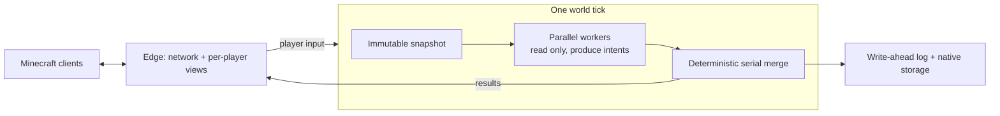

# Solaris

**A Minecraft Java Edition server written from scratch in Rust.**

Solaris is a replacement for the vanilla server (and Paper/Spigot-style servers).
Players join with the normal, unmodified Minecraft **Java 26.3** client; there
are no client mods to install. Solaris reimplements the game itself: world
generation, mobs, redstone, villages, combat and inventories. It is built for two
things the vanilla server is bad at:

- **Using every CPU core.** Vanilla simulates a world on essentially one thread.
  Solaris runs the expensive per-entity work in parallel on all cores. The result
  stays deterministic: the same inputs always produce the same world.
- **Crash-consistent saves.** World, inventories, containers and plugin data
  commit together in a write-ahead log. After a crash or `kill -9` everything
  recovers to the same durable tick: items cannot be duplicated or lost between
  a player and a chest. Only the last few ticks that had not reached the disk
  yet may roll back.

> **Status: Solaris 1.0 "Pauline", release candidate 1.** Ready for real
> servers that need vanilla-client survival, settlements and Wasm plugins. Not
> bit-identical to vanilla, and Java mods do not run (see below).

## Performance

Four reproducible release profiles cover an idle world, exploration and dense
entity simulation. **Quiet-window measurements are pending**; setup/smoke runs
are not published as performance results.

| Profile | Players / bots and entity load | Server RSS peak / steady | MSPT p50 / p95 / p99 / max | TPS |
|---|---|---|---|---|
| Idle world | 0 clients, generated Overworld | pending | pending | pending |
| Exploration | 20 protocol bots exploring fresh terrain | pending | pending | pending |
| Native-100 | 100 protocol bots + 100,000 mixed mobs | pending | pending | pending |
| Villager-heavy | 100 protocol bots + 100,000 mixed mobs + 20,000 villagers | pending | pending | pending |

Reference host: **Ryzen 5 7535HS (6 cores / 12 threads), 32 GB RAM, NVMe SSD,
Ubuntu 26.04.1 / Linux 7.0.0-38**. The server uses four physical cores; bots use
the other two. Release source: `0a86cfffc173d9fe13e9d0795a6c5494fc33a222`.
A separate, already measured **single-threaded in-process generator benchmark**
takes **13.8–17.3 ms/chunk** across three seeds; this excludes lighting, storage
and networking and is **not server chunk throughput**.

See [full conditions, metric definitions, receipts and one-command
reproduction](docs/performance/PROFILES.md). Measurements describe the stated
hardware and workload, not guarantees or vanilla-parity/capacity claims.

## What works

- **Survival basics:** mining, crafting, smelting, farming, breeding, enchanting,
  anvils, brewing, trading, beds, death and respawn, statistics, advancements.
- **World:** vanilla 26.1 terrain, biomes, caves, villages and structures. The
  Nether and the End include portals and the ender dragon fight.
- **Mobs:** passive, neutral and hostile mobs, mounts and vehicles, raids, piglin
  bartering, golems (including player-built iron and snow golems), the warden
  and sculk.
- **Redstone:** pistons, hoppers, comparators, observers and the crafter.
- **Newer content:** trial chambers, vaults, mace, wind charges, copper golems,
  bees, allays, elytra and beacons.
- **Multiplayer:** many players in one world, chat, teams and scoreboards.
- **Operators:** console commands, bans and whitelist, backups, plus an optional
  read-only web dashboard.

Gameplay aims to feel like vanilla, not to be bit-identical. Exact AI timing and
vanilla bugs are not reproduced. The network protocol and world file formats
*are* exact, so normal clients and normal world saves work.

Partial map-making support: directory `/function` datapacks, schedules and
unconditional command blocks. See [the limits and setup](docs/OPERATING.md#datapacks-and-command-blocks).
General `/data`, `/clone`, conditional command blocks and other map-making
commands are not there yet.

## Settlements

Villages are settlements that run themselves. A planner lays out and builds
houses, workshops, storage, mines and camps from real materials; villagers take
building, mining and lumber jobs, keep their work across nights, raise an army
and trade through a settlement economy. Players claim and manage a settlement
through server-driven dialogs, with no client mod. See the short
[player guide (English / Русский)](docs/SETTLEMENTS_GUIDE.md), or
`/settlement guide` and `/help settlement` in game.

## Native client

[Solaris client](https://github.com/kaiserproger/solaris-client) is an
optional native Rust client (wgpu: Vulkan, Metal, DX12) with its own launcher.
It has Low/Medium/High graphics presets (HDR, bloom, shadows, god rays,
reflections), GPU-generated far terrain from the server's `[lod]` channel,
proximity voice chat (`[voice]`, the server only relays Opus packets) and
screen sharing to in-world monitors. Vanilla clients do not need it.

## For server owners

- `content import`, `backup` / `restore`, live console `backup`,
  `world import-anvil` / `export-anvil`, `world census`.
- Bans, whitelist, operators, a block and container history (`/co`), RCON,
  Query, Velocity forwarding and anti-xray.
- An optional read-only web dashboard with live TPS and tick timing.
- Distant Horizons support (`[distant_horizons]`).

Details: the [operating guide](docs/OPERATING.md).

## Mods

Forge, Fabric and NeoForge mods do not run on Solaris: in All the Mods 11,
215 of 289 mods ship server-side Java and 152 rewrite Minecraft internals with
Mixins. A limited set of datapack content (recipes, loot overrides) loads
today; full datapack support and worldgen datapacks are next. Server-side
features are written as [Wasm plugins](#plugins).

## How it works



- Each tick, workers on all cores read an immutable snapshot of the world and
  return *intents* such as "move here" or "attack that". A single merge step
  then applies them in a fixed order, so parallelism never changes the outcome.
- Entity data is laid out for CPU caches. Hot fields sit in dense columns and
  rare data lives out of line, so passes over 100k mobs touch far less memory.
- Storage is a native database plus the tick log. Vanilla Anvil worlds are
  imported and exported with an offline command; the import keeps unknown data
  verbatim.
- Networking and per-player view tracking run on separate threads from the game
  tick.

## Plugins

Plugins are **WebAssembly components** running in the Wasmtime sandbox:

- A plugin cannot crash the server, read your files or block the game tick.
- It declares the capabilities it needs (storage, economy transactions, zones,
  teleports…), and the server refuses everything else.
- Plugin data and receipts commit in the same tick log as the world, so an
  economy purchase is never half-applied after a crash.
- Write plugins in Rust with the [SDK](sdk/rust/), or in any language that
  compiles to WebAssembly components.

Ready-made packages live in
[solaris-default-plugins](https://github.com/kaiserproger/solaris-default-plugins):
permissions, essentials, economy, towns with land claims, and audit. Plugins
that add client-side content use the optional
[Solaris Loader](https://github.com/kaiserproger/solaris-loader) client mod
(Fabric, NeoForge, Forge). Server-only plugins work with vanilla clients. See
the [plugin guide](docs/PLUGINS.md).

## Install

Linux x86-64 and AArch64 binaries are published on
[GitHub Releases](https://github.com/kaiserproger/solaris/releases). You need
`curl`, `tar`, a SHA-256 utility and **JDK 25** (used once to extract game data):

```sh
curl -fsSL https://raw.githubusercontent.com/kaiserproger/solaris/v1.0.0-rc.1/install.sh \
  | SOLARIS_VERSION=v1.0.0-rc.1 bash
curl -fsSLo example.toml \
  https://raw.githubusercontent.com/kaiserproger/solaris/v1.0.0-rc.1/example.toml
```

Solaris does not ship any Mojang files. Before the first start, download the
official server once and let Solaris derive its game data from it:

```sh
solaris content import --version 26.3 --download
solaris --config example.toml
```

The first start creates an empty `plugins/` directory next to the config; copy
packages from `solaris-default-plugins` into it and restart to deploy them.
Deploying `solaris-auth` locks every new session until the player runs
`/register` or `/login`.

Then connect a Minecraft Java 26.3 client to `127.0.0.1:25565`.

> The example config listens on all interfaces with **offline authentication**.
> For anything beyond local testing, set `[auth].online_mode = true` and review
> `[network].bind_address` and your firewall.

To bring an existing vanilla world, stop the server and convert it once:

```sh
solaris --config example.toml world import-anvil \
  --source /worlds/my-vanilla-world --destination /worlds/native --receipt import.json
```

`world export-anvil` converts back. Configuration, backups and the console are
covered in the [operating guide](docs/OPERATING.md).

## Build from source

Install the Rust toolchain pinned in [`rust-toolchain.toml`](rust-toolchain.toml)
and JDK 25. Linux x86-64 builds use Clang and mold, as configured in
[`.cargo/config.toml`](.cargo/config.toml).

```sh
cargo build -p mc-edge --bin solaris-v2
cargo run -p mc-edge --bin solaris-v2 -- content import --version 26.3 --download
cargo run -p mc-edge --bin solaris-v2 -- --config example.toml
```

To use server jars you already have, replace `--download` with
`--from /path/to/26.3/server.jar --gameplay-from /path/to/26.1.2/server.jar`
(see [the content cache](docs/OPERATING.md#vanilla-content-cache)).

## Contributing

See [CONTRIBUTING.md](CONTRIBUTING.md). One command runs the full check (format,
lint, architecture rules, the whole test suite):

```sh
python3 -m tools.harness run correctness
```

More: the [documentation index](docs/README.md), the
[architecture overview](docs/ARCHITECTURE.md) and the
[1.0 release notes](docs/releases/v1.0.0-rc.1.md) (upgrading from v0.0.8 is
covered there).

## License

Dual-licensed under [Apache-2.0](LICENSE-APACHE) or [MIT](LICENSE-MIT), at your
option. Minecraft is a trademark of Mojang AB; Solaris is not affiliated with
Mojang or Microsoft.
