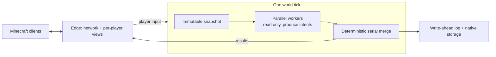

# Solaris

**A Minecraft Java Edition server written from scratch in Rust.**

Solaris is a replacement for the vanilla server (and Paper/Spigot-style servers).
Players join with the normal, unmodified Minecraft **Java 26.1.2** client; there
are no client mods to install. Solaris reimplements the game itself: world
generation, mobs, redstone, villages, combat and inventories. It is built for two
things the vanilla server is bad at:

- **Using every CPU core.** Vanilla simulates a world on essentially one thread.
  Solaris runs the expensive per-entity work in parallel on all cores. The result
  stays deterministic: the same inputs always produce the same world.
- **Never losing or duplicating items.** Every durable change (inventories,
  blocks, containers, plugin data) is written to a write-ahead log before players
  see it, so a crash or `kill -9` resumes from the last committed tick. There is
  no rollback to the last autosave and no duped chests.

> **Status: early preview (v0.0.8, prerelease).** Good for testing, benchmarking
> and plugin development. Not yet a drop-in replacement for a production server.
> Expect breaking changes between versions.

## Numbers

These measurements use a single host with a frame-pointer release build. The
server runs on 8 cores and 100 real protocol clients are scripted bots.

| Scenario | Result |
|---|---|
| 100 players + ~100,000 mixed mobs (cows, zombies, skeletons, villagers…) | ~16 TPS steady, p50 tick 63 ms |
| 100 players + 10,000 mobs on **2 cores** | full 20 TPS |
| 500 players + 500,000 villagers | runs correctly (no desync, no item loss), ~3 TPS |
| Crash test: SIGKILL during play, 145k-chunk world + 5,000 villagers | reopened with every chunk, entity and villager intact |

## What works

- **Survival basics:** mining, crafting, smelting, farming, breeding, enchanting,
  anvils, brewing, trading, beds, death and respawn, statistics, advancements.
- **World:** vanilla 26.1 terrain, biomes, caves, villages and structures. The
  Nether and the End include portals and the ender dragon fight.
- **Mobs:** passive, neutral and hostile mobs, mounts and vehicles, raids, piglin
  bartering, golems (including player-built iron and snow golems), the warden
  and sculk.
- **Redstone:** pistons, hoppers, comparators, observers and the crafter.
- **Newer content:** trial chambers, vaults, mace, wind charges, copper golems,
  bees, allays, elytra and beacons.
- **Multiplayer:** many players in one world, chat, teams and scoreboards.
- **Operators:** console commands, bans and whitelist, backups, plus an optional
  read-only web dashboard.

Gameplay aims to feel like vanilla, not to be bit-identical. Exact AI timing and
vanilla bugs are not reproduced. The network protocol and world file formats
*are* exact, so normal clients and normal world saves work.

Not there yet: command blocks, `/function` datapacks, `/data` / `/clone` and
similar map-making commands.

## How it works



- Each tick, workers on all cores read an immutable snapshot of the world and
  return *intents* such as "move here" or "attack that". A single merge step
  then applies them in a fixed order, so parallelism never changes the outcome.
- Entity data is laid out for CPU caches. Hot fields sit in dense columns and
  rare data lives out of line, so passes over 100k mobs touch far less memory.
- Storage is a native database plus the tick log. Vanilla Anvil worlds are
  imported and exported with an offline command; the import keeps unknown data
  verbatim.
- Networking and per-player view tracking run on separate threads from the game
  tick.

## Plugins

Plugins are **WebAssembly components** running in the Wasmtime sandbox:

- A plugin cannot crash the server, read your files or block the game tick.
- It declares the capabilities it needs (storage, economy transactions, zones,
  teleports…), and the server refuses everything else.
- Plugin data and receipts commit in the same tick log as the world, so an
  economy purchase is never half-applied after a crash.
- Write plugins in Rust with the [SDK](sdk/rust/), or in any language that
  compiles to WebAssembly components.

Ready-made packages live in
[solaris-default-plugins](https://github.com/kaiserproger/solaris-default-plugins):
permissions, essentials, economy, towns with land claims, and audit. Plugins
that add client-side content use the optional
[Solaris Loader](https://github.com/kaiserproger/solaris-loader) client mod
(Fabric, NeoForge, Forge). Server-only plugins work with vanilla clients. See
the [plugin guide](docs/PLUGINS.md).

## Install

Linux x86-64 and AArch64 binaries are published on
[GitHub Releases](https://github.com/kaiserproger/solaris/releases). You need
`curl`, `tar`, a SHA-256 utility and **JDK 25** (used once to extract game data):

```sh
curl -fsSL https://raw.githubusercontent.com/kaiserproger/solaris/v0.0.8/install.sh \
  | SOLARIS_VERSION=v0.0.8 bash
curl -fsSLo example.toml \
  https://raw.githubusercontent.com/kaiserproger/solaris/v0.0.8/example.toml
```

Solaris does not ship any Mojang files. Before the first start, download the
official server once and let Solaris derive its game data from it:

```sh
solaris content import --version 26.1.2 --download
solaris --config example.toml
```

Then connect a Minecraft Java 26.1.2 client to `127.0.0.1:25565`.

> The example config listens on all interfaces with **offline authentication**.
> For anything beyond local testing, set `[auth].online_mode = true` and review
> `[network].bind_address` and your firewall.

To bring an existing vanilla world, stop the server and convert it once:

```sh
solaris --config example.toml world import-anvil \
  --source /worlds/my-vanilla-world --destination /worlds/native --receipt import.json
```

`world export-anvil` converts back. Configuration, backups and the console are
covered in the [operating guide](docs/OPERATING.md).

## Build from source

Install the Rust toolchain pinned in [`rust-toolchain.toml`](rust-toolchain.toml)
and JDK 25. Linux x86-64 builds use Clang and mold, as configured in
[`.cargo/config.toml`](.cargo/config.toml).

```sh
cargo build -p mc-edge --bin solaris-v2
cargo run -p mc-edge --bin solaris-v2 -- content import --version 26.1.2 --download
cargo run -p mc-edge --bin solaris-v2 -- --config example.toml
```

To use a server jar you already have, replace `--download` with
`--from /path/to/server.jar`.

## Contributing

See [CONTRIBUTING.md](CONTRIBUTING.md). One command runs the full check (format,
lint, architecture rules, the whole test suite):

```sh
python3 -m tools.harness run correctness
```

More: the [documentation index](docs/README.md), the
[architecture overview](docs/ARCHITECTURE.md) and the
[v0.0.8 release notes](docs/releases/v0.0.8.md).

## License

Dual-licensed under [Apache-2.0](LICENSE-APACHE) or [MIT](LICENSE-MIT), at your
option. Minecraft is a trademark of Mojang AB; Solaris is not affiliated with
Mojang or Microsoft.
