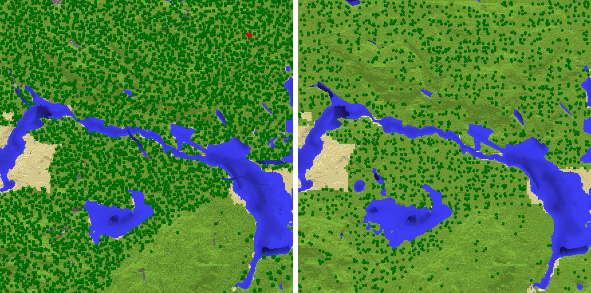
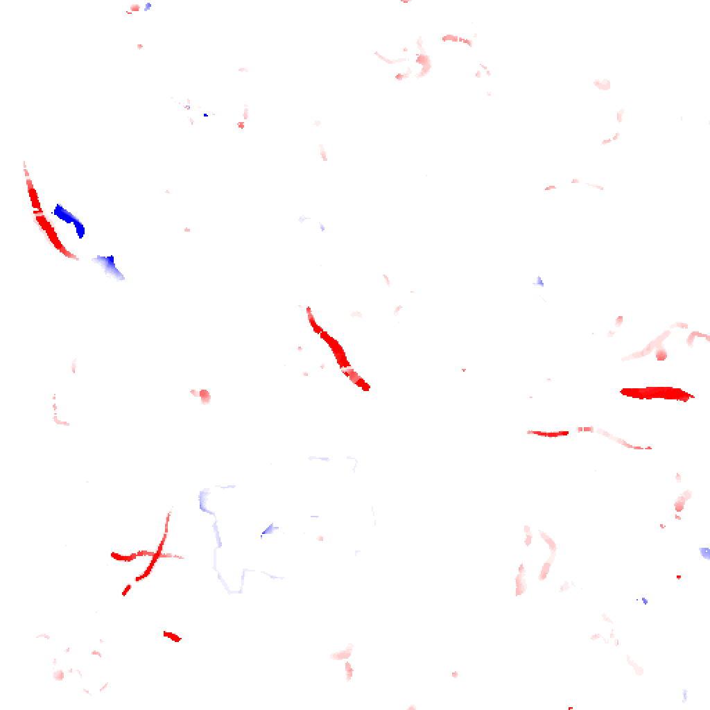
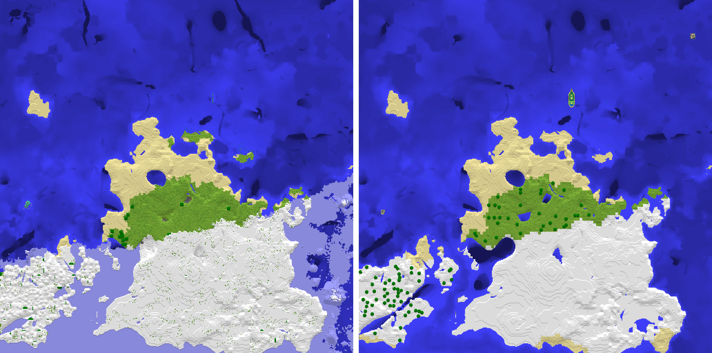
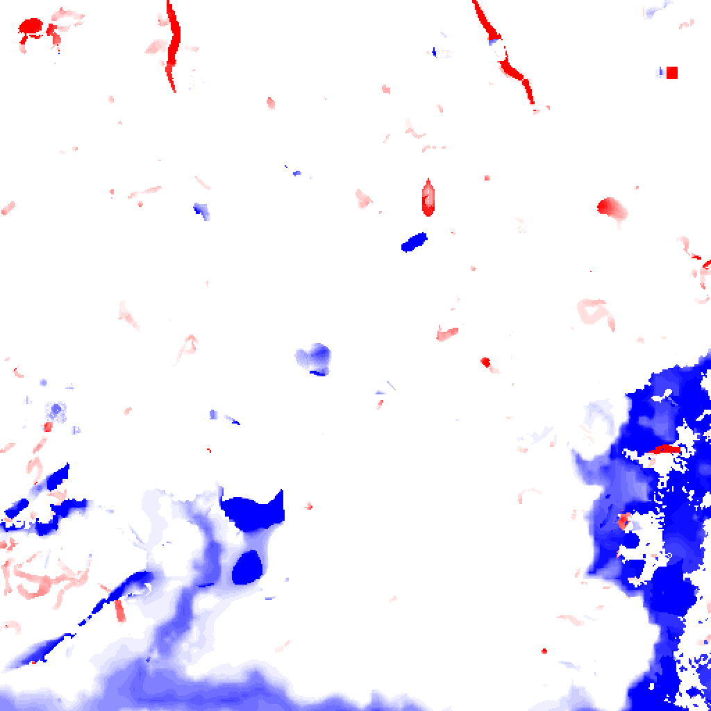
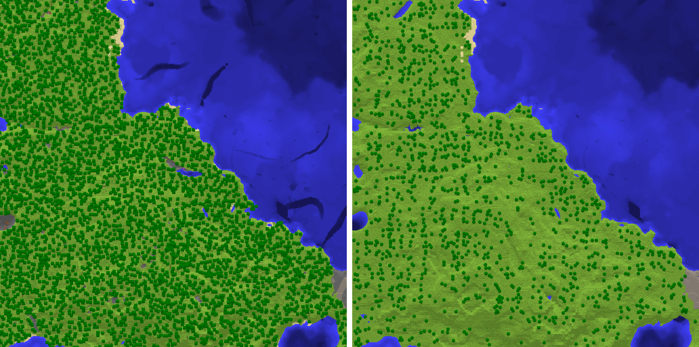
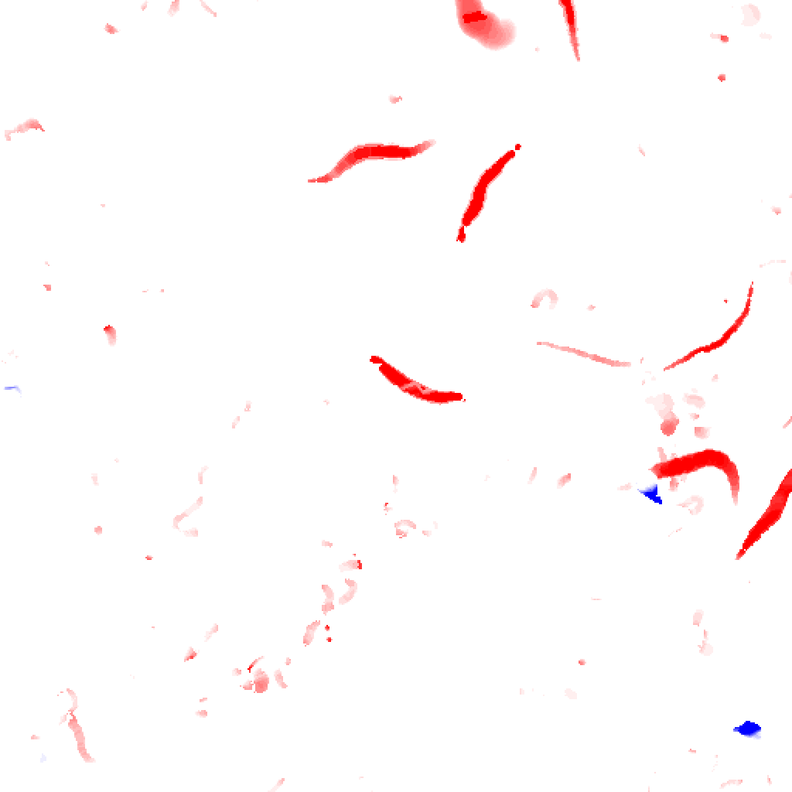

# Solaris vs vanilla 26.1.2 — block-level worldgen diff

Generated 2026-10-28T06:02:17Z by `/usr/bin/python3 -m tools.worldgen_diff --server-bin /run/media/kaiserroman/games/solaris-work/targets/worldgen/release/solaris-v2 --vanilla-jar /home/kaiserroman/solaris/.analysis/server.jar --data-dir /run/media/kaiserroman/games/solaris-work/wt/worldgen/data/vanilla --out .analysis/worldgen-diff/full-final`.

- Solaris HEAD `db0ba531c84c1daeea873ab8d22614968d3eae23`, server binary sha256 `a2ca60290a7c3c7b…`; vanilla bundle sha256 `cd47e7c38328f647…`.
- 1024 chunks per seed (100,663,296 cells, Y -64..319), overworld only; each rectangle is centered on vanilla spawn.
- Vanilla: stock server, `tick freeze` in the datapack load function, `forceload` + FULL halo, `save-all flush`. Solaris: `world pregenerate` + `world export-anvil`.

## Summary

Percentages are of all cells unless marked *non-air* (cells where either side is not air in that metric). *name* ignores block properties; *no decor states* preserves properties except small plants (grass, flowers, kelp, vines, snow layers...) become air/source water and air variants merge. *terrain* ignores properties and also treats trees as air; *shape* folds terrain to air/water/lava/solid. Surface = top solid terrain block per column (Solaris − vanilla).

| seed | exact % | exact non-air % | name non-air % | no-decor states non-air % | terrain non-air % | shape % | biome % | surface err mean/p95/max | surface exact % | structures V / S / same |
|---:|---:|---:|---:|---:|---:|---:|---:|---|---:|---|
| 0 | 91.27 | 74.76 | 74.78 | 74.98 | 75.70 | 98.93 | 99.97 | 0.18 / 0 / 81 | 97.8 | 4 / 1 / 0 |
| 81 | 91.24 | 72.53 | 72.53 | 72.95 | 73.00 | 98.25 | 99.94 | 1.49 / 12 / 73 | 85.2 | 7 / 7 / 3 |
| 497625 | 91.10 | 73.70 | 73.72 | 74.01 | 74.65 | 98.27 | 99.96 | 0.30 / 0 / 64 | 96.6 | 7 / 5 / 2 |

## Generation time (this run, shared host; not a controlled benchmark)

Vanilla also generates a FULL halo around the requested chunks; Solaris times exclude world setup and include light and native storage.

| seed | vanilla generate s | Solaris generate s | Solaris chunks/s |
|---:|---:|---:|---:|
| 0 | 63.671 (cached) | 26.8 | 38.21 |
| 81 | 44.689 (cached) | 22.4 | 45.71 |
| 497625 | 48.535 (cached) | 26.8 | 38.21 |

## Seed 0

Vanilla spawn: `[-32, 69, 0]`. Compared chunks `[-18, -16]`..`[13, 15]`.

Top name confusions (vanilla → Solaris):

| vanilla | Solaris | cells | % of mismatches |
|---|---|---:|---:|
| minecraft:tuff | minecraft:deepslate | 1,156,942 | 13.2 |
| minecraft:andesite | minecraft:stone | 992,735 | 11.3 |
| minecraft:diorite | minecraft:stone | 951,180 | 10.8 |
| minecraft:granite | minecraft:stone | 901,050 | 10.3 |
| minecraft:bedrock | minecraft:deepslate | 519,683 | 5.9 |
| minecraft:air | minecraft:deepslate | 432,759 | 4.9 |
| minecraft:dirt | minecraft:stone | 334,502 | 3.8 |
| minecraft:air | minecraft:stone | 324,029 | 3.7 |
| minecraft:gravel | minecraft:deepslate | 251,990 | 2.9 |
| minecraft:gravel | minecraft:stone | 240,523 | 2.7 |
| minecraft:deepslate | minecraft:stone | 218,606 | 2.5 |
| minecraft:stone | minecraft:deepslate | 217,569 | 2.5 |
| minecraft:oak_leaves | minecraft:air | 162,213 | 1.8 |
| minecraft:stone | minecraft:dirt | 123,064 | 1.4 |
| minecraft:granite | minecraft:deepslate | 111,685 | 1.3 |

Largest block-count differences:

| block | vanilla | Solaris |
|---|---:|---:|
| minecraft:stone | 11,688,708 | 15,460,220 |
| minecraft:deepslate | 14,013,524 | 16,785,177 |
| minecraft:tuff | 1,169,135 | 0 |
| minecraft:andesite | 1,128,464 | 0 |
| minecraft:diorite | 1,076,391 | 0 |
| minecraft:granite | 1,034,725 | 0 |
| minecraft:bedrock | 787,262 | 262,144 |
| minecraft:gravel | 511,700 | 7,772 |
| minecraft:dirt | 944,478 | 704,256 |
| minecraft:oak_leaves | 176,194 | 1,476 |
| minecraft:water | 371,188 | 213,445 |
| minecraft:leaf_litter | 74,230 | 0 |
| minecraft:lava | 38,317 | 2,263 |
| minecraft:sandstone | 30,825 | 0 |
| minecraft:sand | 70,642 | 101,250 |

Match by 16-block layer (name / terrain / shape %):

| y | name | terrain | shape |
|---|---:|---:|---:|
| -64..-49 | 76.5 | 76.5 | 98.1 |
| -48..-33 | 86.0 | 86.0 | 96.6 |
| -32..-17 | 86.9 | 86.9 | 96.9 |
| -16..-1 | 84.3 | 84.3 | 97.1 |
| 0..15 | 60.2 | 60.3 | 96.3 |
| 16..31 | 70.9 | 70.9 | 96.3 |
| 32..47 | 69.6 | 69.6 | 96.6 |
| 48..63 | 72.9 | 73.1 | 97.1 |
| 64..79 | 88.9 | 95.2 | 99.5 |
| 80..95 | 95.3 | 98.1 | 99.8 |
| 96..111 | 99.2 | 99.9 | 100.0 |
| 112..127 | 100.0 | 100.0 | 100.0 |
| 128..143 | 100.0 | 100.0 | 100.0 |
| 144..159 | 100.0 | 100.0 | 100.0 |
| 160..175 | 100.0 | 100.0 | 100.0 |
| 176..191 | 100.0 | 100.0 | 100.0 |
| 192..207 | 100.0 | 100.0 | 100.0 |
| 208..223 | 100.0 | 100.0 | 100.0 |
| 224..239 | 100.0 | 100.0 | 100.0 |
| 240..255 | 100.0 | 100.0 | 100.0 |
| 256..271 | 100.0 | 100.0 | 100.0 |
| 272..287 | 100.0 | 100.0 | 100.0 |
| 288..303 | 100.0 | 100.0 | 100.0 |
| 304..319 | 100.0 | 100.0 | 100.0 |

Structure starts in the rectangle (vanilla / Solaris / same chunk):

- minecraft:mineshaft: 4 / 1 / 0

## Seed 81

Vanilla spawn: `[-576, 68, 432]`. Compared chunks `[-52, 11]`..`[-21, 42]`.

Top name confusions (vanilla → Solaris):

| vanilla | Solaris | cells | % of mismatches |
|---|---|---:|---:|
| minecraft:tuff | minecraft:deepslate | 1,116,194 | 12.7 |
| minecraft:andesite | minecraft:stone | 813,116 | 9.2 |
| minecraft:diorite | minecraft:stone | 777,528 | 8.8 |
| minecraft:granite | minecraft:stone | 732,710 | 8.3 |
| minecraft:water | minecraft:air | 617,907 | 7.0 |
| minecraft:bedrock | minecraft:deepslate | 518,138 | 5.9 |
| minecraft:air | minecraft:deepslate | 336,161 | 3.8 |
| minecraft:stone | minecraft:sand | 250,960 | 2.8 |
| minecraft:gravel | minecraft:deepslate | 241,963 | 2.7 |
| minecraft:dirt | minecraft:stone | 226,982 | 2.6 |
| minecraft:water | minecraft:stone | 223,804 | 2.5 |
| minecraft:stone | minecraft:deepslate | 211,710 | 2.4 |
| minecraft:deepslate | minecraft:stone | 211,032 | 2.4 |
| minecraft:gravel | minecraft:stone | 174,955 | 2.0 |
| minecraft:air | minecraft:stone | 166,447 | 1.9 |

Largest block-count differences:

| block | vanilla | Solaris |
|---|---:|---:|
| minecraft:stone | 8,428,318 | 11,284,322 |
| minecraft:deepslate | 13,484,100 | 16,081,500 |
| minecraft:tuff | 1,130,126 | 0 |
| minecraft:andesite | 960,787 | 0 |
| minecraft:diorite | 929,607 | 0 |
| minecraft:granite | 880,719 | 0 |
| minecraft:water | 2,814,641 | 2,093,394 |
| minecraft:sand | 141,105 | 701,780 |
| minecraft:gravel | 554,959 | 7,512 |
| minecraft:bedrock | 786,020 | 262,144 |
| minecraft:dirt | 525,252 | 252,774 |
| minecraft:snow_block | 495 | 69,312 |
| minecraft:sandstone | 57,348 | 0 |
| minecraft:snow | 56,717 | 0 |
| minecraft:grass_block | 68,496 | 14,946 |

Match by 16-block layer (name / terrain / shape %):

| y | name | terrain | shape |
|---|---:|---:|---:|
| -64..-49 | 77.8 | 77.8 | 98.8 |
| -48..-33 | 86.5 | 86.5 | 97.2 |
| -32..-17 | 86.5 | 86.5 | 96.8 |
| -16..-1 | 83.9 | 83.9 | 96.1 |
| 0..15 | 56.9 | 57.0 | 91.7 |
| 16..31 | 65.4 | 65.4 | 90.0 |
| 32..47 | 61.7 | 61.9 | 91.9 |
| 48..63 | 75.4 | 77.4 | 96.2 |
| 64..79 | 95.9 | 97.6 | 99.5 |
| 80..95 | 99.9 | 99.9 | 99.9 |
| 96..111 | 100.0 | 100.0 | 100.0 |
| 112..127 | 100.0 | 100.0 | 100.0 |
| 128..143 | 100.0 | 100.0 | 100.0 |
| 144..159 | 100.0 | 100.0 | 100.0 |
| 160..175 | 100.0 | 100.0 | 100.0 |
| 176..191 | 100.0 | 100.0 | 100.0 |
| 192..207 | 100.0 | 100.0 | 100.0 |
| 208..223 | 100.0 | 100.0 | 100.0 |
| 224..239 | 100.0 | 100.0 | 100.0 |
| 240..255 | 100.0 | 100.0 | 100.0 |
| 256..271 | 100.0 | 100.0 | 100.0 |
| 272..287 | 100.0 | 100.0 | 100.0 |
| 288..303 | 100.0 | 100.0 | 100.0 |
| 304..319 | 100.0 | 100.0 | 100.0 |

Structure starts in the rectangle (vanilla / Solaris / same chunk):

- minecraft:mineshaft: 4 / 4 / 0
- minecraft:ocean_ruin_cold: 1 / 1 / 1
- minecraft:ruined_portal_ocean: 1 / 1 / 1
- minecraft:shipwreck: 1 / 1 / 1

## Seed 497625

Vanilla spawn: `[-32, 79, 48]`. Compared chunks `[-18, -13]`..`[13, 18]`.

Top name confusions (vanilla → Solaris):

| vanilla | Solaris | cells | % of mismatches |
|---|---|---:|---:|
| minecraft:tuff | minecraft:deepslate | 1,092,423 | 12.2 |
| minecraft:andesite | minecraft:stone | 857,375 | 9.6 |
| minecraft:diorite | minecraft:stone | 812,538 | 9.1 |
| minecraft:granite | minecraft:stone | 786,103 | 8.8 |
| minecraft:water | minecraft:air | 583,223 | 6.5 |
| minecraft:bedrock | minecraft:deepslate | 519,923 | 5.8 |
| minecraft:air | minecraft:deepslate | 403,863 | 4.5 |
| minecraft:dirt | minecraft:stone | 300,808 | 3.4 |
| minecraft:air | minecraft:stone | 300,697 | 3.4 |
| minecraft:gravel | minecraft:deepslate | 232,881 | 2.6 |
| minecraft:gravel | minecraft:stone | 211,068 | 2.4 |
| minecraft:deepslate | minecraft:stone | 199,373 | 2.2 |
| minecraft:stone | minecraft:deepslate | 198,041 | 2.2 |
| minecraft:stone | minecraft:sand | 153,466 | 1.7 |
| minecraft:water | minecraft:stone | 119,061 | 1.3 |

Largest block-count differences:

| block | vanilla | Solaris |
|---|---:|---:|
| minecraft:stone | 10,861,143 | 14,004,020 |
| minecraft:deepslate | 13,007,794 | 15,561,877 |
| minecraft:tuff | 1,108,204 | 0 |
| minecraft:andesite | 996,199 | 0 |
| minecraft:diorite | 946,800 | 0 |
| minecraft:granite | 916,583 | 0 |
| minecraft:water | 2,116,093 | 1,425,522 |
| minecraft:gravel | 533,810 | 5,192 |
| minecraft:bedrock | 787,292 | 262,144 |
| minecraft:sand | 21,068 | 337,109 |
| minecraft:dirt | 763,870 | 526,850 |
| minecraft:oak_leaves | 124,079 | 50 |
| minecraft:leaf_litter | 48,836 | 0 |
| minecraft:birch_leaves | 97,602 | 57,088 |
| minecraft:kelp_plant | 26,763 | 7,748 |

Match by 16-block layer (name / terrain / shape %):

| y | name | terrain | shape |
|---|---:|---:|---:|
| -64..-49 | 77.2 | 77.2 | 98.4 |
| -48..-33 | 86.3 | 86.3 | 96.8 |
| -32..-17 | 86.5 | 86.6 | 96.7 |
| -16..-1 | 83.6 | 83.6 | 94.7 |
| 0..15 | 57.3 | 57.3 | 89.2 |
| 16..31 | 68.2 | 68.2 | 92.2 |
| 32..47 | 65.2 | 65.6 | 94.2 |
| 48..63 | 79.4 | 80.4 | 97.8 |
| 64..79 | 90.4 | 93.9 | 99.0 |
| 80..95 | 94.5 | 97.8 | 99.6 |
| 96..111 | 98.2 | 99.5 | 99.9 |
| 112..127 | 99.9 | 100.0 | 100.0 |
| 128..143 | 100.0 | 100.0 | 100.0 |
| 144..159 | 100.0 | 100.0 | 100.0 |
| 160..175 | 100.0 | 100.0 | 100.0 |
| 176..191 | 100.0 | 100.0 | 100.0 |
| 192..207 | 100.0 | 100.0 | 100.0 |
| 208..223 | 100.0 | 100.0 | 100.0 |
| 224..239 | 100.0 | 100.0 | 100.0 |
| 240..255 | 100.0 | 100.0 | 100.0 |
| 256..271 | 100.0 | 100.0 | 100.0 |
| 272..287 | 100.0 | 100.0 | 100.0 |
| 288..303 | 100.0 | 100.0 | 100.0 |
| 304..319 | 100.0 | 100.0 | 100.0 |

Structure starts in the rectangle (vanilla / Solaris / same chunk):

- minecraft:mineshaft: 5 / 3 / 0
- minecraft:trial_chambers: 2 / 2 / 2
